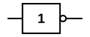
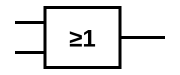
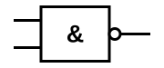
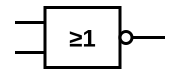
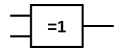
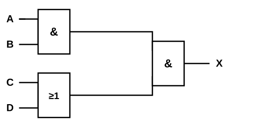
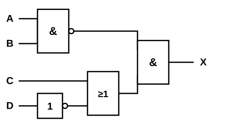

# Digitale poorten en Siemens LOGO!

## Waarom digitale logica?

Onze wereld is fundamenteel analoog: spanningen, temperaturen en geluid veranderen continu en vloeiend. Toch is veel technologie in de loop van de 20e eeuw digitaal geworden: de oude analoge telefoonlijnen, televisies, radio's en modems hebben stuk voor stuk plaatsgemaakt voor digitale varianten.

De reden is dat digitale signalen een aantal praktische voordelen hebben:

- **Robuuster**: een digitaal signaal kent maar 2 toestanden (hoog/laag), waardoor kleine storingen op de lijn het signaal veel minder snel doen kantelen naar de verkeerde waarde.
- **Reproduceerbaar**: een digitaal signaal kan onderweg geregenereerd worden (opnieuw naar een zuivere hoge of lage waarde gebracht), een analoog signaal neemt vervorming cumulatief mee.
- **Programmeerbare circuits**: dezelfde digitale hardware kan door software compleet ander gedrag krijgen, dit maakt de hardware flexibel herbruikbaar.

Analoge techniek verdwijnt daarom niet volledig: voor vermogensaandrijvingen en voor sommige sensortoepassingen blijft analoog de betere of zelfs enige optie. Onze fysieke wereld blijft tenslotte analoog, ook een digitaal systeem moet op een bepaald punt (sensoren, actuatoren) weer naar de analoge wereld schakelen.

## Binaire logica

Binaire logica werd geïntroduceerd door de Engelse wiskundige **George Boole** (1815-1864) in zijn werk "The Laws of Thought" (1854). Zijn doel: een eenduidige, exacte manier om beweringen en redeneringen te beschrijven, zonder de dubbelzinnigheid van natuurlijke taal.

Boole bouwde dit op met slechts **2 mogelijke toestanden**:

- **True / Waar**, genoteerd als **1**
- **False / Niet waar**, genoteerd als **0**

en **3 basisoperatoren**: **En**, **Of** en **Niet**. Alle andere logische bewerkingen (zoals we verderop zien: NEN, NOF, EXOF, EXNOF) zijn combinaties van deze 3 basisoperatoren.

Tenzij uitdrukkelijk anders vermeld, werken we altijd met **positieve logica**: 1 betekent "aan" of "waar" (het hoogste spanningsniveau), 0 betekent "uit" of "niet waar" (het laagste spanningsniveau).

Deze logica vertalen we naar hardware via **digitale poorten** (logic gates): elektronische schakelingen (opgebouwd uit transistoren) die op basis van spanning en stroom een logische bewerking uitvoeren.

### 1, 2 of 3 ingangen

Elke poort heeft een aantal ingangen en 1 uitgang, voorgesteld door een symbool. Een poort kan bijvoorbeeld 1, 2 of 3 ingangen hebben: hoe meer ingangen, hoe meer mogelijke combinaties van ingangswaarden, en dus hoe meer mogelijke reacties de poort kan vertonen.

Elke poort kan volledig beschreven worden met 2 gelijkwaardige hulpmiddelen:

- Een **waarheidstabel**: toont voor elke mogelijke combinatie van ingangen wat de uitgang doet.
- Een **logische vergelijking**: een wiskundige formule die hetzelfde gedrag beschrijft.

## Poortsymbolen: IEC, ANSI, DIN

Eenzelfde poort kan met verschillende symbolen voorgesteld worden, afhankelijk van de gebruikte norm. Datasheets en software kunnen dus onderling verschillen qua symbool, de betekenis van de poort blijft wel altijd hetzelfde. De 3 belangrijkste normen:

- **IEC**: International Electrotechnical Commission
- **ANSI**: American National Standards Institute
- **DIN**: Deutsches Institut für Normung

In deze cursus gebruiken we consequent de **IEC-symbolen**: een rechthoek met daarin een functieletter of -teken (bijvoorbeeld "&" voor EN), met de ingangen links en de uitgang rechts. Een kleine cirkel ("bubble") aan een in- of uitgang betekent een **inversie** (NIET) op dat punt.

## Basis poorten

### Buffer poort

Een buffer poort verandert de logische waarde niet (Q = A), maar wordt in de praktijk gebruikt om:

- Het signaal te **versterken** (een zwak signaal terug op volle sterkte brengen).
- Als **repeater**: een signaal over een langere afstand bruikbaar te houden.
- Een **belasting aan te sturen** (load driving) die meer stroom nodig heeft dan de voorgaande trap kan leveren.
- De uitgang op een **ander spanningsniveau** te brengen dan de ingang.

| A | Q |
|---|---|
| 0 | 0 |
| 1 | 1 |

Vergelijking: **Q = A**

### NIET (NOT) poort

De NIET-poort inverteert de ingang: ze geeft het tegenovergestelde van wat erin komt.

| A | Q |
|---|---|
| 0 | 1 |
| 1 | 0 |

Vergelijking: **Q = Ā** (ook genoteerd als Q = NOT A)

### EN (AND) poort

De uitgang van een EN-poort is enkel 1 als **alle** ingangen 1 zijn. Dit komt overeen met een wiskundige **vermenigvuldiging**.

| A | B | Q |
|---|---|---|
| 0 | 0 | 0 |
| 0 | 1 | 0 |
| 1 | 0 | 0 |
| 1 | 1 | 1 |

Vergelijking: **Q = A·B** (ook genoteerd als Q = A ∧ B)

### OF (OR) poort

De uitgang van een OF-poort is 1 zodra **minstens 1** van de ingangen 1 is. Dit komt overeen met een wiskundige **optelling**.

| A | B | Q |
|---|---|---|
| 0 | 0 | 0 |
| 0 | 1 | 1 |
| 1 | 0 | 1 |
| 1 | 1 | 1 |

Vergelijking: **Q = A+B** (ook genoteerd als Q = A ∨ B)

## Samengestelde poorten

Deze poorten zijn telkens een combinatie van de basispoorten hierboven: een basispoort gevolgd door een NIET.

### NEN (NAND) poort

Het omgekeerde van een EN-poort: EN gevolgd door NIET.

| A | B | Q |
|---|---|---|
| 0 | 0 | 1 |
| 0 | 1 | 1 |
| 1 | 0 | 1 |
| 1 | 1 | 0 |

Vergelijking: **Q = (A·B)̄**

### NOF (NOR) poort

Het omgekeerde van een OF-poort: OF gevolgd door NIET.

| A | B | Q |
|---|---|---|
| 0 | 0 | 1 |
| 0 | 1 | 0 |
| 1 | 0 | 0 |
| 1 | 1 | 0 |

Vergelijking: **Q = (A+B)̄**

### EXOF (XOR) poort

De uitgang is 1 als de ingangen **verschillend** zijn ("exclusief OF": ofwel A, ofwel B, maar niet allebei).

| A | B | Q |
|---|---|---|
| 0 | 0 | 0 |
| 0 | 1 | 1 |
| 1 | 0 | 1 |
| 1 | 1 | 0 |

Vergelijking: **Q = A ⊕ B**

### EXNOF (XNOR) poort

Het omgekeerde van EXOF: de uitgang is 1 als de ingangen **gelijk** zijn.

| A | B | Q |
|---|---|---|
| 0 | 0 | 1 |
| 0 | 1 | 0 |
| 1 | 0 | 0 |
| 1 | 1 | 1 |

Vergelijking: **Q = (A ⊕ B)̄**

## Oefeningen op papier

### Van vergelijking naar schema en waarheidstabel

Teken voor elke vergelijking het poortenschema (met IEC-symbolen) en stel de waarheidstabel op:

1. X = A·B + Ā·C
2. X = A·B·C·D + A·D̄
3. X = A·C + A

> Tip bij oefening 3: reken de tabel volledig uit en kijk goed naar de kolom van X. Valt je iets op in vergelijking met de kolom van A alleen? Dit is een voorproefje van wat we zien in het hoofdstuk Vereenvoudigen.

### Van waarheidstabel naar schema en vergelijking

Bouw het schema en leid de vergelijking af uit deze waarheidstabel:

| A | B | X |
|---|---|---|
| 0 | 0 | 1 |
| 0 | 1 | 1 |
| 1 | 0 | 1 |
| 1 | 1 | 0 |

### Van schema naar vergelijking en waarheidstabel

**Schema 1**: leid de logische vergelijking en de volledige waarheidstabel (4 ingangen A, B, C, D) af uit dit schema.

**Schema 2**: leid de logische vergelijking en de volledige waarheidstabel (4 ingangen A, B, C, D) af uit dit schema.

## Basis werken in LOGO!Soft Comfort

Siemens **LOGO!** is een compacte, programmeerbare logicamodule, veel gebruikt in kleinschalige installatie- en automatiseringstoepassingen. **LOGO!Soft Comfort** is de bijhorende PC-software waarmee je een schakelprogramma tekent, offline simuleert, en pas daarna (optioneel) naar het fysieke toestel doorstuurt. Voor deze les werken we uitsluitend in de simulatiesoftware, geen fysieke LOGO!-module nodig.

### De werkomgeving

Bij het opstarten kies je voor een nieuw programma in **FBD** (Function Block Diagram): dit is de weergave met functieblokken en symbolen, zoals we die ook in deze cursus gebruiken (LOGO! ondersteunt daarnaast ook een ladderdiagram-weergave, LAD, die we hier niet gebruiken).

De werkomgeving bestaat uit:

- Een **werkgebied** (het witte canvas) waar je het schema opbouwt via **drag-and-drop**.
- Een **boomstructuur** aan de zijkant waarmee je snel een functieblok kiest, onderverdeeld in:
  - **Co** (Connectors): in- en uitgangen (bijvoorbeeld I1, I2 voor ingangen, Q1 voor een uitgang).
  - **GF** (Basic functions): de basispoorten EN, OF, NIET, NEN, NOF, EXOF (in LOGO! simpelweg AND, OR, NOT, NAND, NOR, XOR genoemd).
  - **SF** (Special functions): timers, tellers en andere uitgebreide functies, voor latere lessen.

### Belangrijk: geen apart EXNOF-blok

LOGO! voorziet **geen aparte EXNOF (XNOR)-blok** in de GF-lijst. Wil je een EXNOF-functie bouwen, dan combineer je gewoon een **EXOF-blok gevolgd door een NIET-blok**: dat is exact wat EXNOF betekent (zie hierboven).

### Een eenvoudig schema opbouwen

1. Sleep de ingangen die je nodig hebt (bijvoorbeeld I1 en I2) vanuit **Co** naar het werkgebied.
2. Sleep de gewenste poort vanuit **GF** naar het werkgebied (bijvoorbeeld AND).
3. Verbind elke ingang met een pin van de poort: klik op de connector-pin van het blok en teken de verbindingslijn naar de volgende pin.
4. Sleep een uitgang (bijvoorbeeld Q1) vanuit **Co** naar het werkgebied en verbind de uitgang van je poort ermee.
5. Start de **offline simulatie**: je kan dan de ingangen I1/I2 manueel aan- of uitzetten en zien hoe de uitgang Q1 reageert, zonder dat er een fysieke LOGO!-module aangesloten moet zijn.

## Oefeningen in LOGO!Soft Comfort

Bouw en simuleer in LOGO!Soft Comfort:

1. Een EN-poort met 2 ingangen, en test alle 4 combinaties in de simulatie. Komt dit overeen met je waarheidstabel van hierboven?
2. Een NEN-poort met 2 ingangen (AND-blok gevolgd door een NOT-blok, of rechtstreeks het NAND-blok).
3. Een EXNOF-poort met 2 ingangen. Denk aan de opmerking hierboven: welke 2 blokken heb je hiervoor nodig?
4. Bouw schema 1 uit de papieren oefeningen hierboven (A, B, C, D als ingangen) volledig na in LOGO!, en simuleer alle combinaties om je eigen waarheidstabel te controleren.
5. Doe hetzelfde voor schema 2.
